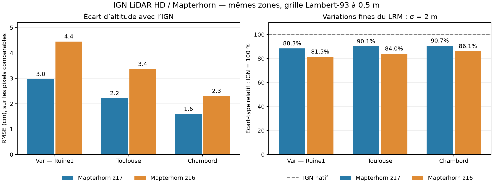
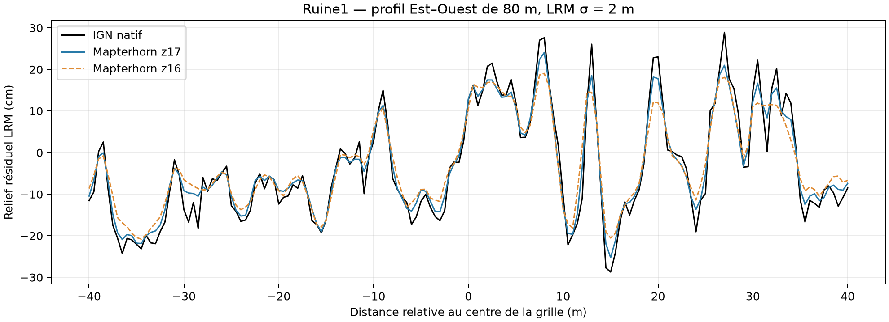
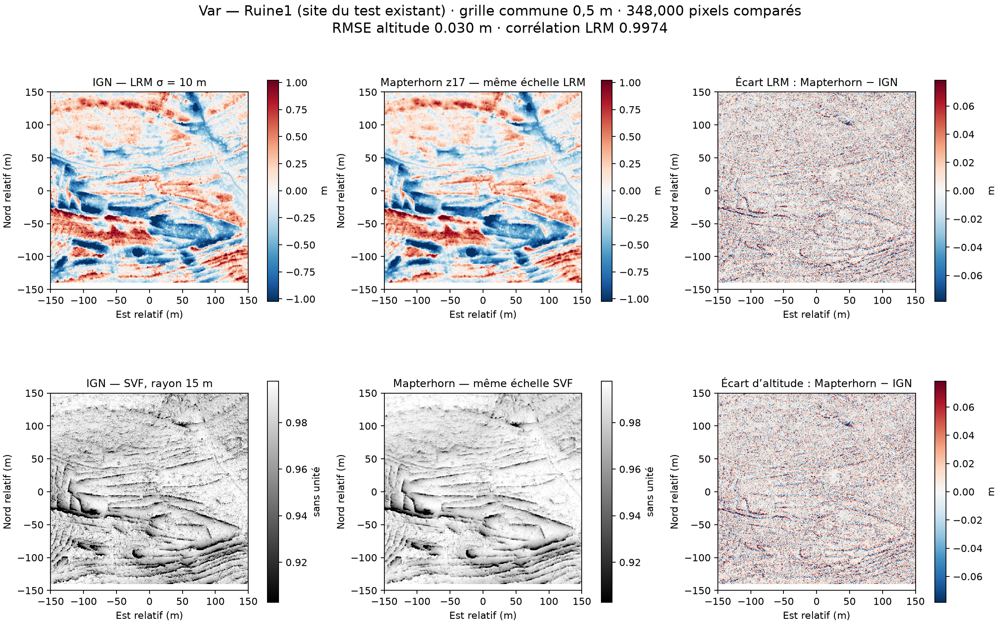
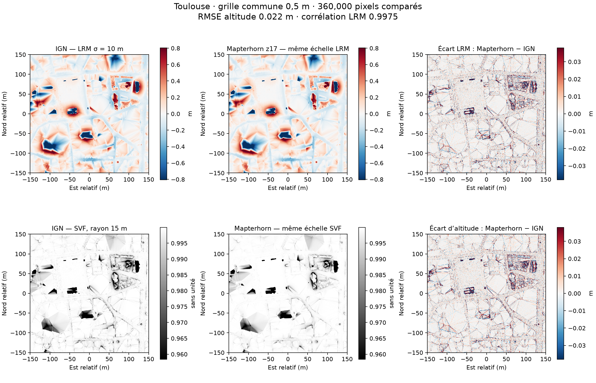
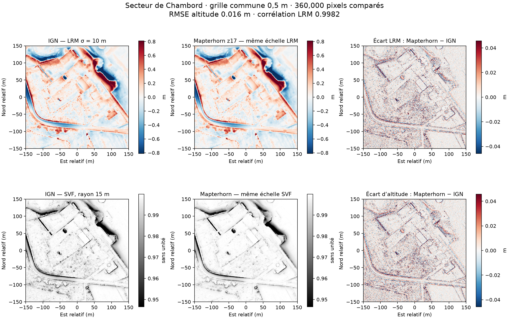

# Comparaison Mapterhorn / provider IGN LiDAR HD

Mesures effectuées le 3 octobre 2026, avec des téléchargements réels. Aucun
provider, fichier de calcul, réglage GUI/CLI ou comportement préexistant n'a
été modifié. Les nouveaux candidats restent inactifs.

**Sur les trois zones françaises testées, Mapterhorn z17 restitue très bien
le relief général du MNT IGN, avec 1,6 à 3,0 cm d'écart d'altitude RMSE.
Il atténue cependant les variations fines : l'écart-type du LRM à sigma 2 m
diminue de 9,3 à 11,7 %. Pour la prospection archéologique fine, conserver
le provider IGN existant lorsque son accès est disponible.**

Ces écarts comparent deux produits numériques ; ils ne mesurent pas leur
précision absolue par rapport au terrain. L'atténuation statistique du LRM
ne signifie pas que chaque fossé, talus ou vestige perd le même pourcentage
de hauteur : ce signal contient aussi du bruit et des effets d'interpolation.

## Données et emprises

La référence est exactement le MNT servi par le provider existant `fr-ign` :
URL `url_mnt` de l'index officiel IGN, dont BBOX, résolution, dimensions,
couche, CRS et nom de fichier sont contrôlés contre
[fr_ign.py](../../providers/fr_ign.py). Ce sont des GeoTIFF d'altitude à
0,5 m, en Lambert-93, provenant du programme LiDAR HD.

Mapterhorn référence ce MNT dans ses sources `frhd2154a` à `frhd2154e`.
Le masque de couverture MVT z14 a confirmé une source HD sur les trois
zones retenues. Les polygones sont généralisés et les sources se superposent :
ils ne prouvent pas la provenance exacte de chaque pixel près d'un raccord.

| Zone | Centre WGS84 (longitude, latitude) | Dalle IGN | Acquisition IGN / édition | Source HD déclarée par Mapterhorn |
|---|---|---|---|---|
| Var — Ruine1 | 5,86628 ; 43,37579 | 0932-6258 | 25/06/2021 / 14/03/2025 | `frhd2154d` |
| Toulouse | 1,444 ; 43,604 | 0574-6280 | 29/05–15/06/2022 / 20/12/2024 | `frhd2154c` |
| Secteur de Chambord | 1,516 ; 47,614 | 0588-6725 | 11/01/2024 / 20/12/2024 | `frhd2154a` |

Ruine1 reprend le point du smoke test du provider LAZ existant. Toulouse
est un contrôle urbain ; Chambord est un secteur du parc avec des formes
géométriques de terrain. Le point du Mont Beuvray (4,0361 ; 46,9241) a été
exclu : l'index IGN consulté ne renvoyait aucun MNT HD et Mapterhorn indiquait
du RGE ALTI, sans source `frhd2154` au centre. Aucun résultat grossier n'a été
substitué à une comparaison LiDAR HD manquante.

L'index IGN expose les dates ci-dessus. Les tuiles RGB Mapterhorn ne donnent
pas le millésime d'acquisition ou l'édition de chaque dalle source. L'identité
exacte de campagne/édition entre les deux produits n'est donc **pas prouvée**.
Une mise à jour locale peut contribuer aux différences, même si la famille
de données et la résolution déclarées sont identiques.

## Méthode et contrôles

- Fenêtre de travail de 400 × 400 m, incluant 50 m de halo autour d'un cœur
  de 300 × 300 m. Le cœur reste aligné sur les pixels IGN livrés : le MNT de
  référence n'est pas rééchantillonné.
- Décodage des WebP RGB Terrarium Mapterhorn de 512 × 512 pixels. Assemblage
  des tuiles adjacentes dans leur grille Mercator **avant** une reprojection
  bilinéaire unique sur la grille IGN à 0,5 m. Cette étude évalue les données
  distribuées, pas l'ensemble du chemin CLI des candidats inactifs.
- Mesures sur l'intersection valide des deux produits et de la couverture
  HD déclarée, à plus de 40 m des NoData et limites de cette couverture.
  Au z17 : 348 000 pixels pour Ruine1 et 360 000 pour chaque autre zone,
  soit **1 068 000 pixels** et **0,267 km²** au total.
- Même fonction `_lrm_array` du projet pour chaque produit : sigma 2, 5 et
  10 m, convertis en pixels par division par 0,5 m.
- Même fonction `_svf_numpy` : rayon 15 m, 16 directions, convention flux
  du projet. Mesures sur les valeurs brutes, sans stretch ou gamma.
- Les cartes utilisent les mêmes échelles IGN / Mapterhorn pour chaque
  variable ; la carte d'écart a une échelle distincte, affichée en mètres.
- Témoin d'identité IGN : recopie sur sa propre grille, différence exactement
  nulle. Grilles, masques, effectifs, RMSE et images de différences relus dans
  les GeoTIFF exportés et vérifiés.
- Diagnostic de translation sur le LRM sigma 5 m : grille de déplacements
  de −0,5 à +0,5 m, pas 0,25 m, environ 20 000 pixels par zone. Le meilleur
  déplacement est **0 m** sur les six comparaisons. Aucune correction de
  position n'a été appliquée aux résultats principaux.

Le WMS IGN retourne ici un WKT dont l'autorité EPSG n'est pas reconnue par
GDAL. Les paramètres de projection Lambert-93 et le CRS demandé ont été
contrôlés ; EPSG:2154 a servi aux calculs. Le fichier IGN reçu et le provider
existant sont conservés tels quels.

## Résultats au zoom 17

Les pas au sol approximatifs des pixels Mercator z17 sont 0,434 m dans le
Var, 0,432 m à Toulouse et 0,403 m à Chambord. Le pas d'arrondi vertical
documenté pour ce zoom est 1/64 m, soit 1,5625 cm. Ce pas d'encodage n'est
pas une précision de mesure et ne crée pas de détail supplémentaire.

| Zone | RMSE altitude | 95 % des écarts absolus ≤ | Corrélation LRM sigma 10 m | Écart-type LRM sigma 2 m, IGN = 100 % |
|---|---:|---:|---:|---:|
| Var — Ruine1 | 2,97 cm | 5,93 cm | 0,99740 | 88,34 % |
| Toulouse | 2,22 cm | 2,35 cm | 0,99748 | 90,10 % |
| Chambord | 1,60 cm | 3,25 cm | 0,99819 | 90,66 % |

Les biais médians sont très faibles : +0,244 cm dans le Var, +0,012 cm à
Toulouse, +0,063 cm à Chambord. Les écarts moyens faibles ne bornent pas tous
les pixels : des écarts absolus locaux atteignent **0,62 m**, **1,67 m** et
**0,39 m** respectivement. Dans les trois zones, moins de 0,8 % des pixels
comparés dépassent 10 cm d'écart. Les différences se concentrent notamment
sur les variations fines et les ruptures de relief/interpolation visibles.
Leur cause exacte n'est pas attribuée à un seul traitement.

| Zone | RMSE SVF brute, sans unité | Corrélation SVF | Écart-type SVF, IGN = 100 % |
|---|---:|---:|---:|
| Var — Ruine1 | 0,01038 | 0,95020 | 77,86 % |
| Toulouse | 0,00657 | 0,98203 | 87,78 % |
| Chambord | 0,00446 | 0,96732 | 83,75 % |

Le SVF est sensible aux pentes et aux petits accidents du terrain. Son
contraste brut est plus faible dans les sorties Mapterhorn. Un stretch
indépendant des images aurait pu masquer cet effet ; les cartes comparées
conservent la même échelle.

## Effet du zoom et témoin simulé

Le zoom 16 a aussi été testé, avec les mêmes paramètres métriques de calcul.
Ses pixels au sol sont approximativement deux fois plus grands que ceux du
z17. Reprojeter cette donnée sur une grille finale de 0,5 m ne restitue pas
les variations supprimées au niveau inférieur de la pyramide.

| Zone | RMSE altitude z16 | Écart-type LRM sigma 2 m z16, IGN = 100 % | RMSE du témoin simulé z17 |
|---|---:|---:|---:|
| Var — Ruine1 | 4,45 cm | 81,48 % | 2,32 cm |
| Toulouse | 3,36 cm | 84,02 % | 1,72 cm |
| Chambord | 2,30 cm | 86,07 % | 1,24 cm |

Le témoin prend le MNT IGN, le reprojette bilinéairement sur la même grille
Mercator que les tuiles, arrondit à 1/64 m au z17 ou 1/32 m au z16, puis le
reprojette sur la grille IGN. Il ne reproduit ni toute la chaîne Mapterhorn,
ni un raccord de sources, ni ses versions de données. Il produit déjà une
part notable des différences et de l'atténuation fine. Cela montre que
reprojection et arrondi suffisent à modifier le signal ; cela ne permet pas
d'attribuer toute la différence observée à ces opérations.



Le profil ci-dessous passe Est–Ouest par le centre de la grille du test
Ruine1, sur 80 m. Son emplacement est fixé par le point du test existant,
sans sélectionner le pic le plus favorable à une conclusion. Il montre que
des pics et creux étroits sont arrondis, davantage au z16. Leur nature
archéologique n'a pas été identifiée ou vérifiée sur le terrain dans ce test.



## Cartes comparées







Les cartes du zoom 16 sont également disponibles : [Var](var_ruine1_z16.png),
[Toulouse](toulouse_z16.png), [Chambord](chambord_z16.png).

## Portée pour lidar2map

Mapterhorn apparaît exploitable pour lire et visualiser les MNT LiDAR HD sur
ces zones, avec une forte ressemblance aux reliefs IGN. Il ajoute néanmoins
une transformation qui atténue les variations fines. Pour l'objectif du
projet, l'accès IGN existant conserve la priorité ; ce test ne justifie pas
son remplacement.

Cette comparaison porte sur **des MNT**, pas sur les nuages COPC LAZ du
provider `fr-ign-laz`. Mapterhorn ne fournit pas ces points classés ni les
retours nécessaires à la construction d'un DFM de structures debout.

Trois petites zones françaises ne qualifient pas tous les pays, les raccords
entre sources ou tous les types de vestiges. Les prototypes Wallonie et
Slovaquie restent à comparer à leurs propres données natives. Aucun des trois
candidats n'est activé par cette étude.

## Résultats conservés et reproduction

- [Mesures CSV](mesures.csv), [résultats JSON avec entrées HTTP, dates et SHA-256](resultats.json).
- [Graphique de synthèse SVG](synthese.svg), [profil SVG](profil_ruine1.svg).
- [Script isolé](../../tools/provider_candidates/compare_ign_mapterhorn.py).

Depuis la racine du projet :

```powershell
rtk proxy python -X utf8 tools/provider_candidates/compare_ign_mapterhorn.py --probe
rtk proxy python -X utf8 tools/provider_candidates/compare_ign_mapterhorn.py --compare --zooms 17 16
rtk proxy python -X utf8 tools/provider_candidates/compare_ign_mapterhorn.py --report
```

Les entrées brutes et les GeoTIFF comparables restent dans
`cache/mapterhorn-comparison-ign/`, séparés du cache utilisé par l'application.
Les URL publiques ne sont pas toutes versionnées : leurs valeurs peuvent
évoluer. Les sommes SHA-256 conservées permettent de détecter un changement
d'entrée lors d'une nouvelle évaluation. Les résultats JSON/CSV et figures
ci-dessus constituent l'archive de cette exécution.

Sources documentaires : [MNT LiDAR HD officiel](https://www.data.gouv.fr/datasets/mnt-lidar-hd),
[source Mapterhorn IGN HD](https://github.com/mapterhorn/mapterhorn/blob/main/source-catalog/frhd2154a/metadata.json),
[téléchargeur IGN utilisé par Mapterhorn](https://github.com/wipfli/frhd-download/blob/main/download.py),
[traitements Mapterhorn](https://github.com/mapterhorn/mapterhorn/blob/main/pipelines/README.md),
[accès aux tuiles](https://mapterhorn.com/data-access/).
